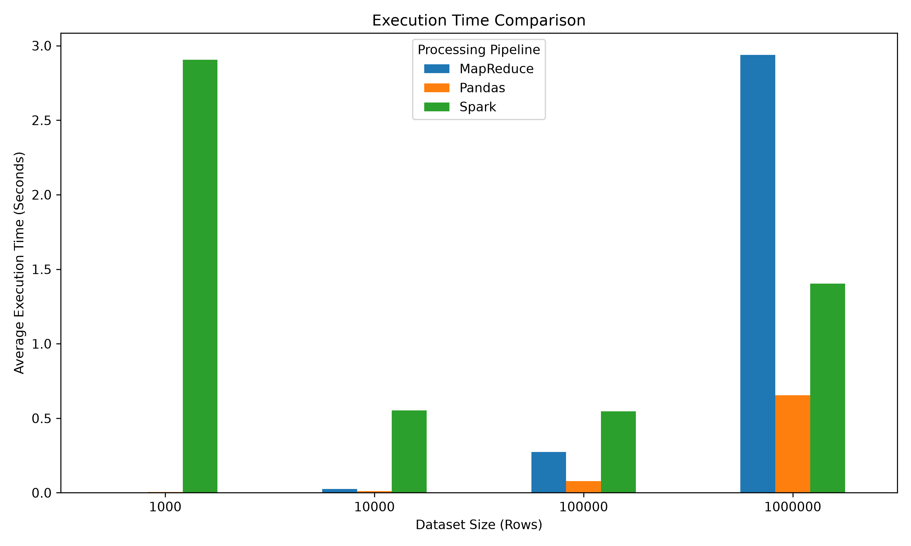
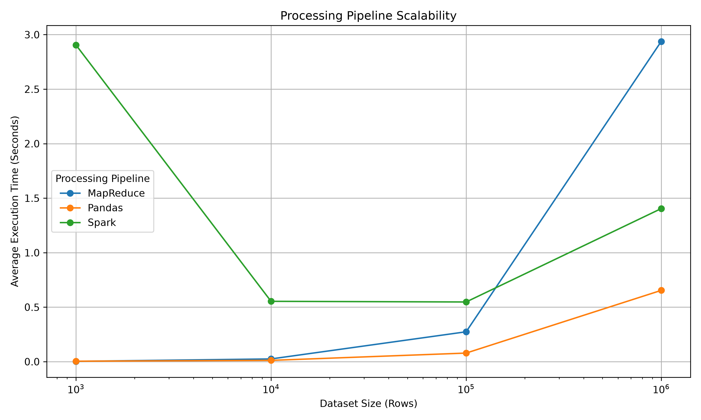
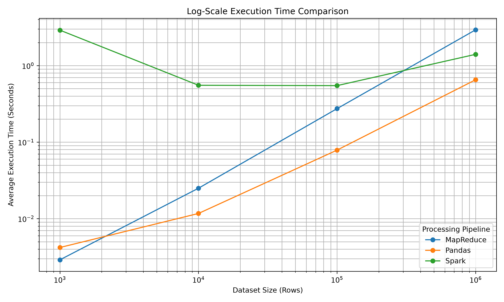

# Ad Budget Optimizer

### Advertising Analytics and Budget Recommendation Using Pandas, MapReduce, and Apache Spark

The **Ad Budget Optimizer** answers one business question: **where should a company spend its next Rs. 1,000,000 of advertising budget?**

It generates synthetic advertising data for five platforms (Facebook, Instagram, Google, TikTok, YouTube), calculates marketing metrics with three different processing approaches (**Pandas, MapReduce, Apache Spark**), compares their performance, and produces a recommended budget split.

---

## Table of Contents

- [Project Overview](#project-overview)
- [Objectives](#objectives)
- [Technologies](#technologies-used)
- [System Architecture](#system-architecture)
- [Dataset Information](#dataset-information)
- [Project Structure](#project-structure)
- [Installation](#installation-and-setup)
- [Running the Application](#running-the-application)
- [Benchmarking Methodology](#benchmarking-methodology)
- [Benchmark Results](#benchmark-results)
- [Performance Visualizations](#performance-visualizations)
- [Advertising Analytics](#advertising-analytics)
- [Budget Recommendation Engine](#budget-recommendation-engine)
- [Reproducibility and Data Management](#reproducibility-and-data-management)
- [Limitations](#limitations)
- [Conclusion](#conclusion)
- [Author](#author)

---

## Project Overview

Digital advertising platforms generate large volumes of campaign data. Analyzing it efficiently is important for budget decisions.

This project addresses two questions:

1. **Processing performance:** how do Pandas, MapReduce and Spark compare as the data grows?
2. **Advertising optimization:** how should Rs. 1,000,000 be split across five advertising platforms?

## Objectives

- Generate reproducible synthetic advertising data (1,000 to 1,000,000 records).
- Calculate CTR, CPC, CPA, CPM, conversion rate, ROAS and revenue per platform.
- Implement the same analysis in Pandas, MapReduce and Apache Spark.
- Benchmark all three over four dataset sizes (3 repetitions each) and confirm they produce identical results.
- Build a budget recommendation engine that splits Rs. 1,000,000 across platforms.

---

## Technologies Used

| Technology | Purpose |
|---|---|
| Python | Core programming language |
| NumPy | Synthetic data generation |
| Pandas | Data processing and the Pandas pipeline |
| MapReduce | Mapper and reducer based processing (pure Python) |
| Apache Spark / PySpark | Distributed data processing (local mode) |
| Matplotlib | Benchmark charts |
| Java 17 | Spark runtime requirement |

---

## System Architecture

1. **Dataset generation:** creates synthetic data using a fixed random seed.
2. **Dataset validation:** checks that the required datasets exist and generates any that are missing.
3. **Data processing:** each dataset goes through the three independent pipelines.
4. **Metric calculation:** CTR, CPC, CPA, CPM, conversion rate, ROAS and revenue per platform.
5. **Benchmarking:** measures execution time of each pipeline.
6. **Visualization:** generates comparison charts.
7. **Recommendation:** scores platforms and splits the Rs. 1,000,000 budget.

**Pandas pipeline:** groups records by platform with DataFrames and calculates the metrics.
**MapReduce pipeline:** a mapper turns each record into a platform-keyed record, and a reducer sums them per platform and calculates the metrics.
**Spark pipeline:** uses PySpark DataFrames (`groupBy` and aggregation) in local mode.

---

## Dataset Information

| Dataset | Records |
|---|---:|
| Dataset 1 | 1,000 |
| Dataset 2 | 10,000 |
| Dataset 3 | 100,000 |
| Dataset 4 | 1,000,000 |

**Platforms:** Facebook, Instagram, Google, TikTok, YouTube. Each platform has its own behaviour profile (click-through rate, conversion rate, cost per thousand impressions), defined in `src/platform_profiles.py`.

**Columns:** `date`, `campaign_id`, `platform`, `impressions`, `clicks`, `conversions`, `spend`, `revenue`, `age`, `gender`, `city`, `device`.

Records follow a realistic funnel: impressions, then clicks (a fraction of impressions), then conversions (a fraction of clicks), then revenue (conversions times order value). Therefore clicks never exceed impressions and conversions never exceed clicks.

### Scale and Scope Note

The project brief describes datasets of up to 10 million records. Due to laptop hardware limits, this project was benchmarked up to 1,000,000 records. Dataset sizes are defined in `DATASET_SIZES` in `src/config.py`, and the generator creates data in chunks of 100,000 rows. Larger sizes can be added by editing that list, but sizes above 1,000,000 have not been tested in this project.

### Reproducible Data Generation

The generator uses `RANDOM_SEED = 42`, so the same data is produced every time. Missing datasets are generated automatically before processing.

---

## Project Structure

    ad-budget-optimizer/
    |
    |-- src/
    |   |-- benchmark.py
    |   |-- campaign_analysis.py
    |   |-- config.py
    |   |-- data_generator.py
    |   |-- main.py
    |   |-- mapreduce_pipeline.py
    |   |-- metrics.py
    |   |-- pandas_pipeline.py
    |   |-- platform_profiles.py
    |   |-- recommendation.py
    |   |-- spark_pipeline.py
    |
    |-- data/
    |   |-- raw/
    |   |   |-- marketing_data_10000.csv    (10K sample kept in Git)
    |   |-- processed/                      (not tracked)
    |
    |-- outputs/
    |   |-- benchmarks/benchmark_results.csv
    |   |-- charts/
    |   |   |-- execution_time_comparison.png
    |   |   |-- scalability_comparison.png
    |   |   |-- log_scale_comparison.png
    |   |-- recommendation.csv
    |   |-- campaign_performance.csv
    |
    |-- generate_charts.py
    |-- README.md
    |-- .gitignore

---

## Installation and Setup

### Prerequisites

- Python 3.10 or later
- Java Development Kit (JDK) 17 (required by Spark)
- Git

### 1. Clone the repository

    git clone https://github.com/daniyalshahid2006/ad-budget-optimizer.git
    cd ad-budget-optimizer

### 2. Create and activate a virtual environment (Windows PowerShell)

    python -m venv venv
    .\venv\Scripts\Activate.ps1

### 3. Install dependencies

    pip install numpy pandas matplotlib pyspark

### 4. Configure Java 17

Install JDK 17, set the `JAVA_HOME` environment variable to its folder, and verify with `java -version`. Spark prints Windows Hadoop warnings (such as "winutils.exe not found"), which are harmless.

---

## Running the Application

    python .\src\main.py

This checks for the required datasets (generating any that are missing), runs the Pandas, MapReduce and Spark pipelines on every dataset size, and generates the budget recommendation.

Running the benchmark (3 repetitions per pipeline and size, separate from `main.py`):

    python .\src\benchmark.py

Regenerating the charts from the saved benchmark results (does not re-run the benchmark):

    python .\generate_charts.py

---

## Benchmarking Methodology

Every pipeline performs the same job on the same data: group by platform, sum the raw fields, and calculate the metrics. Each pipeline is run 3 times on each of the 4 dataset sizes (36 runs in total) and the average time is reported. The three pipelines produce identical metric values on every dataset.

Results are saved to `outputs/benchmarks/benchmark_results.csv`.

---

## Benchmark Results

Average execution time in seconds (5 platforms, 3 runs each):

| Dataset Size | Pandas | MapReduce | Spark |
|---|---:|---:|---:|
| 1,000 | 0.0042 | 0.0029 | 2.9054 |
| 10,000 | 0.0117 | 0.0250 | 0.5535 |
| 100,000 | 0.0787 | 0.2741 | 0.5475 |
| 1,000,000 | 0.6539 | 2.9378 | 1.4043 |

### Analysis

- **Small data:** Pandas and MapReduce are almost instant. Spark has start-up overhead, and its first 1,000-row run (7.08 s) includes starting the Spark engine, which inflates the average.
- **Growing data:** Pandas stays the fastest at every size tested. The pure-Python MapReduce slows down fastest as data grows, because it processes records one at a time.
- **At 1,000,000 records:** Spark (1.40 s) is about twice as fast as MapReduce (2.94 s), and its time grows much more slowly than the other two. Pandas (0.65 s) is still faster in this single-machine test; a crossover with Spark was not reached within the tested range.

These measurements describe the tested laptop and are not universal performance guarantees.

---

## Performance Visualizations

---

## Advertising Analytics

| Metric | Formula |
|---|---|
| CTR (%) | `clicks / impressions * 100` |
| CPC | `spend / clicks` |
| CPA | `spend / conversions` |
| CPM | `spend / impressions * 1000` |
| Conversion Rate (%) | `conversions / clicks * 100` |
| ROAS | `revenue / spend` |
| Revenue | sum of revenue |

Metrics are calculated from **totals** (total revenue divided by total spend), not by averaging row-level ratios. Division by zero returns 0.

---

## Budget Recommendation Engine

The engine analyzes the 1,000,000-record dataset and splits **Rs. 1,000,000** across the five platforms.

**Method**

1. Calculate each platform's ROAS, CPA and conversion rate.
2. Score each platform from 0 to 1 on every metric (CPA is inverted, since lower is better).
3. Combine into one score: ROAS 50%, CPA 25%, conversion rate 25%.
4. Convert scores to budget shares that sum to 100%.
5. Apply business constraints: each platform gets at least 5% and at most 40%.
6. Convert shares to rupee amounts (totalling exactly Rs. 1,000,000) and estimate expected revenue as budget times ROAS.

**Results**

| Rank | Platform | ROAS | CPA | Current Spend Share | Recommended Share | Budget (Rs.) | Expected Revenue (Rs.) |
|---:|---|---:|---:|---:|---:|---:|---:|
| 1 | Google | 16.98 | 5.00 | 25.5% | 29.5% | 294,624 | 5,002,716 |
| 2 | Instagram | 12.77 | 6.66 | 26.5% | 22.7% | 227,465 | 2,904,728 |
| 3 | Facebook | 11.25 | 7.56 | 22.5% | 20.2% | 201,557 | 2,267,516 |
| 4 | YouTube | 8.31 | 10.23 | 14.3% | 15.7% | 157,199 | 1,306,324 |
| 5 | TikTok | 7.27 | 11.68 | 11.2% | 11.9% | 119,155 | 866,257 |

Total allocated: Rs. 1,000,000. Total expected revenue: about Rs. 12.35 million.

Results are saved to `outputs/recommendation.csv`.

---

## Campaign Performance

`src/campaign_analysis.py` groups the 1,000,000-record dataset by `campaign_id` (100 campaigns) and calculates impressions, clicks, conversions, spend, revenue, profit (revenue minus spend), CTR, CPC, CPA, conversion rate and ROAS for each campaign. Campaigns are ranked by ROAS and saved to `outputs/campaign_performance.csv`.

    python .\src\campaign_analysis.py

In this synthetic dataset, campaign IDs are assigned randomly, so campaign results are similar to each other (ROAS ranges from about 12.0 to 12.5). The table demonstrates the method; real campaigns would normally show a much wider spread.

---

## Reproducibility and Data Management

- A fixed random seed (42) makes the data identical on every run.
- Missing datasets are generated automatically, so large files do not need to be stored in Git.
- Only the 10,000-row sample dataset is tracked in Git; the other raw datasets and the intermediate processed files are excluded.
- Source code, benchmark results, the recommendation and the charts are tracked.

---

## Limitations

- The data is synthetic, so the recommendation shows the method and not real advertising performance.
- Expected revenue assumes each platform keeps its current ROAS at the new spend level. In practice, returns usually shrink as spend increases.
- Benchmarks were run on a single laptop up to 1,000,000 records. Sizes up to 10 million were not tested.
- MapReduce is implemented as a pure-Python mapper and reducer, not on a Hadoop cluster.

---

## Conclusion

The project compares three data processing approaches on advertising data and turns the analysis into a budget decision. All three tools produce identical metrics. Pandas is fastest on the tested single machine, Spark scales best of the distributed-style approaches, and the budget engine recommends giving the largest share (29.5%) to Google, which has the best ROAS and lowest CPA, while keeping TikTok at 11.9% because of its weak conversion rate.

---

## Author

**Daniyal Shahid**

GitHub: [@daniyalshahid2006](https://github.com/daniyalshahid2006)